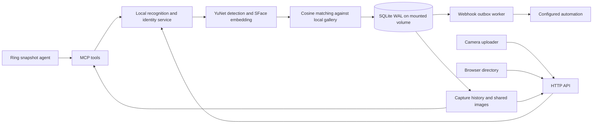

# KnownFaces

KnownFaces is a self-hosted face directory for camera snapshots. Send it a JPEG or PNG, tag detected faces in the local web UI, then ask an AI agent connected over the Model Context Protocol (MCP), “When were the last two sightings of the person tagged Demo Visitor?” Images, embeddings and the SQLite gallery stay on your host.

## Run locally

With Docker running, execute `docker compose up -d --build` in this directory. Open [the face directory](http://127.0.0.1:8093/) and sign in with the admin token from the following command. It prints a credential to your local terminal.

```sh
docker compose exec knownfaces python -m knownfaces.manage token admin
```

The Linux image downloads the pinned models at build time, verifies their SHA-256 digests, and includes their licenses. Runtime inference works offline. Compose uses one application worker and stores credentials, SQLite data and original images in the `gallery` volume. Local agents connect on loopback. Keep the local port and bearer credentials private.

### Try a synthetic snapshot

With the service running, use the following commands in a POSIX shell. They create a blank PNG in the container and submit it under a fictional camera ID. The response should report `face_count: 0`. This records one synthetic snapshot in your local gallery.

```sh
docker compose exec -T knownfaces python -c "from PIL import Image; import sys; Image.new('RGB',(128,128)).save(sys.stdout.buffer,'PNG')" > demo.png
curl --fail -H "Authorization: Bearer $(docker compose exec -T knownfaces python -m knownfaces.manage token ingest)" \
  -F camera_id=demo-camera -F event_id=demo-001 -F image=@demo.png http://127.0.0.1:8093/v1/snapshots
```

Connect a local AI agent to `http://127.0.0.1:8093/mcp` with a read token to query the gallery. Remote access is disabled by default. The optional remote MCP process on port 8094 uses delegated Entra permissions. Direct ChatGPT-to-Entra sign-in and refresh still need live verification. [Remote MCP setup](docs/remote-mcp.md) · [Azure gateway and deployment](docs/azure-operations.md)

## Architecture



Python 3.13, OpenCV, NumPy, FastAPI, SQLite and the official Python MCP SDK run in one process. The UI uses local HTML, CSS and JavaScript. One identity can have many samples. Each camera observation connects one identity to one snapshot. Reference enrollment adds a gallery sample without creating a camera sighting. Shared appearances are calculated from observations with the same snapshot ID.

Recognition checks a normalized 128-value embedding against up to eight exemplars per identity, keeps the top score for each person, and applies a minimum similarity and a margin over the next identity. Distinct faces in one image receive distinct IDs. Score defaults are 0.82 for detection, 0.48 for cosine similarity and 0.06 for the margin. Use `KF_DETECT`, `KF_MATCH`, `KF_MARGIN` and `KF_THREADS` to tune a deployment. Detection confidence and identity similarity have different meanings. A similarity value is not a probability of identity. [OpenCV model implementation](https://github.com/opencv/opencv_zoo/blob/main/models/face_recognition_sface/demo.py)

## API and MCP

The API reference is available at [local interactive docs](http://127.0.0.1:8093/docs). API and MCP clients send `Authorization: Bearer <token>`. Retrieve role-specific tokens with the same operator command using `ingest` or `read`. Admin can perform every operation. Use an ingest credential for recording and a read credential for queries.

```sh
curl -H "Authorization: Bearer $KF_INGEST_TOKEN" \
  -F camera_id=front-door -F event_id=ring-019 \
  -F captured_at=2026-11-24T07:25:00Z -F image=@doorbell.jpg \
  http://127.0.0.1:8093/v1/snapshots

curl -G -H "Authorization: Bearer $KF_READ_TOKEN" \
  --data-urlencode "name=Alex Smith" -d camera_id=front-door -d limit=2 \
  http://127.0.0.1:8093/v1/sightings
```

A recognition result includes `snapshot_id`, `camera_id`, UTC `captured_at`, `has_faces`, `face_count`, image-level `detection_confidence`, `recognition_ms` and a `faces` array. Each observation carries `person_id`, optional `full_name`, pixel box `[x,y,width,height]`, detection confidence, nullable match similarity and `previous_seen_at`. The previous time is the last stored capture strictly earlier than this one. The camera/event ID pair makes retries idempotent. History queries use capture order with a snapshot-ID tie breaker. Tagging changes the name shown in queries while the recorded recognition response remains available for replay.

Connect a Streamable HTTP MCP client to `http://127.0.0.1:8093/mcp`. The Ring agent invokes `recognize_snapshot` with `camera_id`, `image_base64`, optional `event_id` and optional `captured_at`. Both transports accept JPEG and PNG up to 12 MiB and 16 megapixels. `find_sightings` supports a person ID or name, camera, time interval, cursor and limit. `get_cooccurrences` returns supporting snapshot IDs for each pair.

MCP 2026-07-28 clients can resolve duplicate names through the MRTR form exchange. A client without form support receives the candidate IDs. A client advertising `io.modelcontextprotocol/tasks` can set `deferred=true` to receive a durable task handle. Poll `tasks/get` or subscribe with `subscriptions/listen` and `notifications.taskIds`. Set `Mcp-Name` to the task ID for task methods. Queued recognition can be cancelled. Work already executing can be polled to completion. [MRTR specification](https://modelcontextprotocol.io/specification/2026-07-28/basic/patterns/mrtr) · [Tasks extension](https://tasks.extensions.modelcontextprotocol.io/specification/2026-07-28/tasks)

## Webhooks

Set `KF_WEBHOOK` and `KF_WEBHOOK_SECRET` in the Compose environment to enable callbacks. After the snapshot commits, a worker posts its JSON result. Verify `X-KnownFaces-Signature` against `sha256=` followed by the hexadecimal HMAC-SHA256 of the raw body using the shared secret. Deduplicate by `X-KnownFaces-Event`, which equals the snapshot ID. Eight failed attempts leave the delivery in a failed state. Admins can inspect `GET /v1/deliveries` and request redelivery with `POST /v1/deliveries/{id}/retry`.

## Capacity and verification

The gallery is designed for hundreds of identities. At 500 identities × 8 exemplars × 128 float32 values, the raw matching matrix takes about 2 MiB. SQLite holds images and crops on disk. Actual storage growth depends on image size and capture frequency.

Run `python -m scripts.ci` for the synthetic Python suite, gateway tests, strict OpenSpec and Bicep checks, and an offline container smoke test. CI uses generated test markers. To benchmark the real detector locally, install `requirements.txt` and pytest, run `python -m knownfaces.models`, then `python -m scripts.benchmark`. The benchmark downloads checksum-verified third-party portraits. Camera resolution, hardware and gallery size affect latency.

For camera-specific calibration, prepare a CSV with `path,person,split,light`. Use `reference` and `test` splits with separate images, a consistent person label, and `day` or `night`. Include visitors absent from the reference gallery. Use one expected face per image. Run `python -m scripts.calibrate manifest.csv` to compare threshold and margin combinations. The report separates detection errors, wrong identities and missed identities. Defaults have not been calibrated on the user's cameras.

## Backup and restore

Create a consistent snapshot of the running database with a new filename. The SQLite backup includes identities, camera images, observations, task state and the webhook outbox.

```sh
docker compose exec knownfaces python -m knownfaces.manage backup /tmp/knownfaces-backup.db
docker compose cp knownfaces:/tmp/knownfaces-backup.db ./knownfaces-backup.db
```

To restore into a **fresh volume**, copy the backup to `/data/knownfaces.db` before starting the service and give the container user (UID 10001) read/write access. Keep the original volume until the restored service's image and identity counts have been checked. Preserve `/data/credentials.json` separately to retain existing tokens, or allow the fresh instance to generate new ones. Pending webhook deliveries can resume when the destination is configured. Inspect volume usage with `docker compose exec knownfaces du -sh /data`.

## License

The KnownFaces source code is available under the [MIT License](LICENSE). The build downloads YuNet and SFace with their own licenses and includes the notices in the local image. The source repository contains no model weights or portrait fixtures. [YuNet license](https://github.com/opencv/opencv_zoo/blob/47534e27c9851bb1128ccc0102f1145e27f23f98/models/face_detection_yunet/LICENSE) · [SFace license](https://github.com/opencv/opencv_zoo/blob/47534e27c9851bb1128ccc0102f1145e27f23f98/models/face_recognition_sface/LICENSE)
